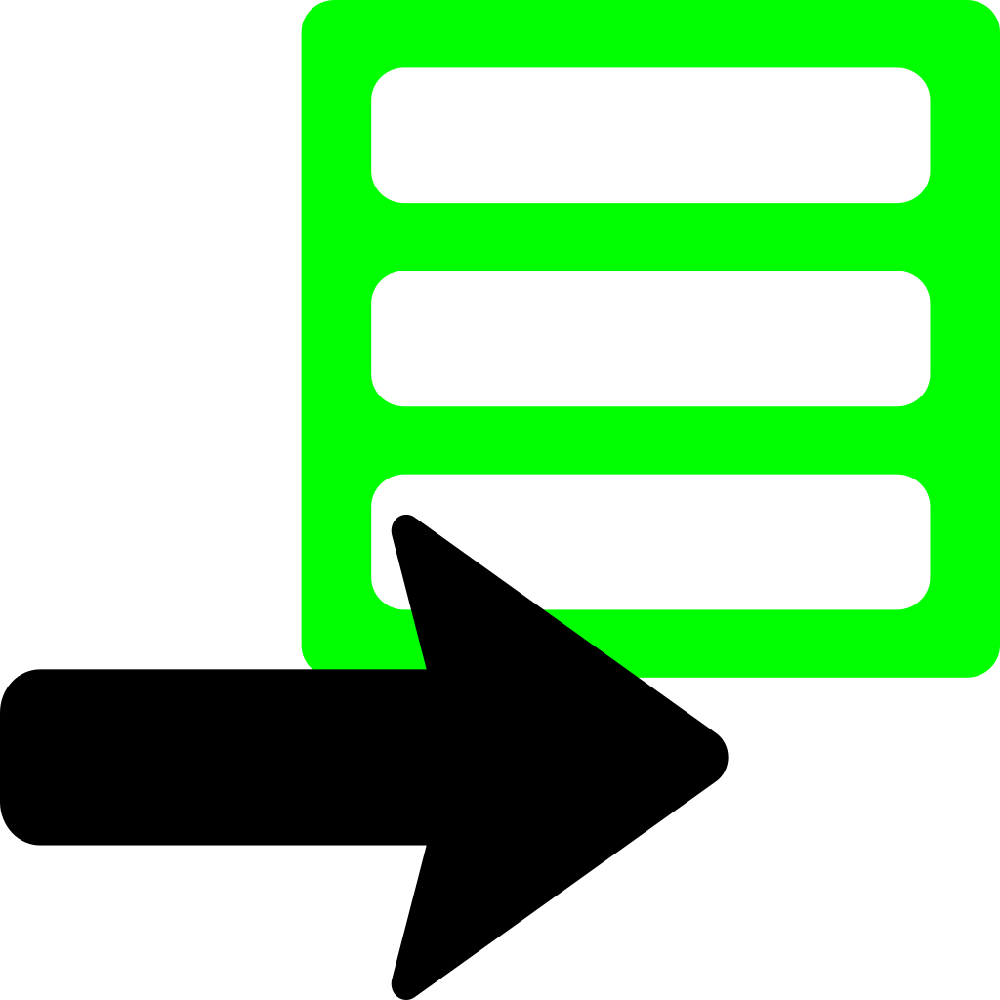

# Godot-CommandExportPlugin

A export plugin using [ToolEditorExportPlugin](https://github.com/NovaDC/Godot-Novatools/blob/0a663b3e6f371f6bbe4116c31eaac0853da32cab/addons/novatools/tool_editor_export_plugin.gd "ToolEditorExportPlugin's script as hosted on Github") to provide the ability for full CLI shell commands to be run during export.

Requires the [NovaTools](https://github.com/NovaDC/Godot-Novatools "NovaTools Github Repository") plugin as a dependency.

